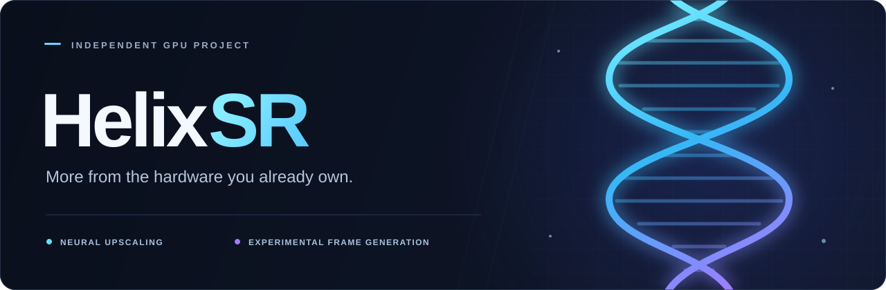

<p align="center">
  
</p>

<p align="center">
  <a href="https://github.com/lonewolf0622/HelixSR/releases">
    
  </a>
  &nbsp;
  <a href="https://discord.gg/XwxcPD4GR">
    
  </a>
  &nbsp;
  <a href="https://www.paypal.com/donate/?business=WL2384PF9Z9W6&amp;no_recurring=0&amp;currency_code=USD">
    
  </a>
</p>

<p align="center">
  <a href="#whats-in-helixsr">What's in it</a> ·
  <a href="#gpus">GPUs</a> ·
  <a href="#install">Install</a> ·
  <a href="#performance">Performance</a> ·
  <a href="#troubleshooting">Troubleshooting</a> ·
  <a href="#community">Community</a>
</p>

<p align="center">
  Windows &amp; Linux / Proton · Version 3.3.0 ·
  <a href="LICENSE">HelixSR Freeware License</a>
</p>

---

# HelixSR

**Modern AI upscaling for graphics cards that were left out of it.**

HelixSR runs NVIDIA's DLSS networks and AMD's FSR 4 networks as ordinary GPU compute shaders, so they work on cards that
have no Tensor Cores, no FP8 and no official support: older AMD Radeon cards, the AMD BC-250, NVIDIA GTX cards and more.
No NVIDIA driver, CUDA or ROCm is needed. It works in DirectX 12, DirectX 11 and Vulkan games, on Windows and on Linux
(Proton, Steam Deck).

You install it per game with **HelixSR Desktop** (an app) or the setup scripts. In the game you pick the game's own DLSS
option, and switch between HelixSR's upscalers in an in-game menu (**Insert**).

> [!IMPORTANT]
> **HelixSR is made for older graphics cards.** It is developed and tested on the AMD BC-250 (gfx1013) under Linux.
> Other GPUs and Windows are not tested by us; see [GPUs](#gpus) for what is expected to work.

HelixSR is an independent, unofficial project and is **not affiliated with or endorsed by NVIDIA or AMD**.

## What's in HelixSR

| Upscaler | Network | Character | Where you pick it |
|---|---|---|---|
| **HLX DLSS** (default) | NVIDIA DLSS Model E | Fast, stable, every quality mode from DLAA to Ultra Performance | the game's **DLSS** option |
| **HLX DLSS, Preset K** (optional) | NVIDIA DLSS 4 Preset K | Sharper than Model E, about 2.5x its cost | HelixSR Scaler's **DLSS Upscaler** list |
| **HLX FSR 4** | AMD FSR 4 Lite (FSR 4.1.2) | AMD's smaller FSR 4 network on HelixSR's own pipeline; fast | HelixSR Scaler's upscaler list, or as an FSR 3.1 drop-in |
| **HLX FSR 4 Full** | AMD FSR 4 (FSR 4.1.2, full network) | The full FSR 4 picture; sharper and slower than HLX FSR 4 | HelixSR Scaler's upscaler list (BC-250, RDNA 1, RDNA 2, RDNA 3, Steam Deck) |

Around them:

- **HelixSR Scaler**: HelixSR's version of [OptiScaler](https://github.com/optiscaler/OptiScaler) (GPL-3.0, [source](https://github.com/lonewolf0622/HelixSR-Scaler)).
  It turns the game's DLSS, FSR or XeSS option into HLX DLSS and lists HelixSR's other upscalers next to AMD FSR and Intel
  XeSS, including their frame generation.
- **HelixSR Desktop**: sets HelixSR up once, installs, updates and removes it per game, and has a speed test.

> [!NOTE]
> **HelixSR 3.x has no frame generation of its own.** AMD FSR and Intel XeSS frame generation can be picked in HelixSR
> Scaler's menu.

## New in 3.3.0

- **HLX FSR 4 Full should work on more GPUs:** the BC-250 and RDNA 1 on Windows too, and RDNA 2 (RX 6000), RDNA 3 (RX 7000)
  and the Steam Deck. Its BC-250 kernels are about 2.5% faster, and its files are half the size.
- **HLX DLSS runs natively in Vulkan games** instead of through a DirectX 12 bridge.
- **HLX FSR 4 in Vulkan games** through HelixSR Scaler.
- **Preset K on Windows:** all of its layers run as DirectX 12 shaders now, and a new `Int8` setting uses 8-bit math on GPUs
  with fast 8-bit dot products.
- **NVIDIA GTX 10:** HLX DLSS and HLX FSR 4 are much faster under Linux / Proton (they now take the same 32-bit paths as on
  Windows), and HLX DLSS's faster Quality output kernel runs over a wider range of resolutions.
- HelixSR Scaler 2.3.0.

The full notes, including known issues, are in each release.

## GPUs

| GPU | HLX DLSS | Preset K | HLX FSR 4 | HLX FSR 4 Full |
|---|---|---|---|---|
| **AMD BC-250** (our test GPU) | ✅ tested | ✅ tested | ✅ tested | ✅ tested (Linux) |
| **AMD RDNA 1** (RX 5000) | ✓ expected | ✓ expected | ✓ expected | ✓ expected |
| **AMD RDNA 2** (RX 6000, Steam Deck, Ryzen 6000 graphics) | ✓ expected, int8 | ✓ expected, int8 | ✓ expected | ✓ expected (INT8) |
| **AMD RDNA 3 and newer** | may work | may work | may work | ✓ expected on RDNA 3 (INT8) |
| **Radeon Vega / Radeon VII, RX 400 / 500** | experimental | – | experimental | – |
| **NVIDIA GTX 16** | ✓ expected | ✓ expected | ✓ expected | – |
| **NVIDIA GTX 10** | ✓ expected (32-bit path) | – | ✓ expected (32-bit path) | – |
| **Intel Arc** | should work | should work | should work | – |

"Expected" means the GPU gets its own tuned path but we have not run it ourselves. Reports help: open an issue with
`helixsr.log`, or send the results of HelixSR Desktop's speed test.

## Install

### HelixSR Desktop (recommended)

Download **HelixSR Desktop** from the [latest release](https://github.com/lonewolf0622/HelixSR/releases/latest) (Windows:
the `.exe` installer; Linux / Steam Deck: the `.AppImage` or `.deb`) and run it. It sets HelixSR up on your PC once and then
installs it into your games with one button each:

- **HelixSR Scaler** for most games: HLX DLSS through the game's own DLSS, FSR or XeSS option, HelixSR's other upscalers in
  its list, and an in-game menu (**Insert**).
- **FSR drop-in** for games with FSR 3.1 (under *Advanced*): only the game's FSR file is replaced with HLX FSR 4.

It also updates and removes HelixSR per game, shows each game's log for bug reports, puts back everything it replaced, and
has a **speed test** (top bar).

### Setup scripts (without the app)

1. Download `HelixSR-3.3.0.zip` and extract it into a folder you keep (for example `C:\HelixSR` or your home folder).
2. Close your games and run the setup in that folder:
   - **Windows:** double-click `helixsr-setup.bat`
   - **Linux / Steam Deck:** `./helixsr-setup.sh` (in a terminal, or double-click and choose *Run in terminal*)
3. The first time, it asks before each download and builds HLX DLSS on your PC from NVIDIA's DLSS DLL (downloaded from
   NVIDIA). It asks whether to build Preset K too. This takes a while; what it builds is kept, so later releases reuse it.
4. It lists your games (Steam, Epic, GOG, Xbox, Heroic, Lutris), numbered, with what each has (DLSS, FSR 3.1, XeSS) and what
   is installed. Type a game's number (or drag a game's folder into the window), then **Enter** to install it the recommended
   way, or **s** = HelixSR Scaler (pick **DLSS** in the game), **f** = FSR drop-in (games with FSR 3.1: pick **AMD FSR** in
   the game), **r** = remove. Pick as many games as you like; **Enter** on its own when done.
5. Start the game. **Insert** opens HelixSR Scaler's menu.

**A game that is not listed:** run `./helixsr-setup.sh /path/to/game`, or drop the game's folder onto `helixsr-setup.bat`.

### By hand

Run the setup once first (steps 1 to 3 above; at the game list press **Enter** on its own): it builds HLX DLSS into
`HelixSR\helixsr.dll`. Then copy into the game's folder with its .exe (Unreal Engine games: `Binaries\Win64`):

1. From `helixsr-scaler`: `OptiScaler.dll` renamed to **`dxgi.dll`** (if the game already has a `dxgi.dll`, name it
   `winmm.dll` or `version.dll` instead), `OptiScaler.ini`, and the whole `OptiScaler` folder (it holds HLX FSR 4 and
   HLX FSR 4 Full; keep its files as they are).
2. The whole **`HelixSR`** folder, next to `dxgi.dll`.

```
Game\
  game.exe
  dxgi.dll            (OptiScaler.dll, renamed)
  OptiScaler.ini
  OptiScaler\         (HLX FSR 4, HLX FSR 4 Full, AMD FSR, XeSS, ...)
  HelixSR\            (helixsr.dll = HLX DLSS, helixsr.ini; k\ = Preset K if you built it)
```

On Linux, `dxgi.dll` needs no launch option; with `winmm.dll` or `version.dll` add `WINEDLLOVERRIDES="winmm=n,b" %command%`
(or `version=n,b`) to the game's launch options. For one game at a time there are scripts in `helixsr-scaler`
(`setup_linux.sh`), and on Windows the [HelixSR Scaler release](https://github.com/lonewolf0622/HelixSR-Scaler/releases/latest)
has `setup_windows.bat`.

## Update

- **HelixSR Desktop:** when a new version is out, the app shows **Update HelixSR to x.y.z** at the top; press it, then
  **Update** on each game.
- **Setup scripts:** extract the new ZIP and run the setup again; pick each game that has HelixSR (marked in the list) and
  press **Enter**.
- **By hand:** run the new setup, then copy the same files over the old ones. Keep the game's `OptiScaler.ini` if you changed it.

Your game settings are kept every way.

## Settings

The upscaler and sharpening are picked in HelixSR Scaler's menu (**Insert**). Restart the game after changing a file.

- **HLX DLSS:** `[HelixSR]` in the game's `OptiScaler.ini` (copied to `HelixSR\helixsr.ini` when the game starts):
  `Int8` = `auto` / `on` / `off`, `WaveSize` = `auto` / `64` / `32` (leave on `auto` unless the picture is broken).
- **Preset K:** `HelixSR\k\helixsr.ini`: `Int8` = `auto` / `on` / `off`; `DeepReuse` = `Exact` (default), `1:2` or `1:4`
  (the deeper layers every second or fourth frame: faster, with some loss in motion).
- **HLX FSR 4 Full:** `OptiScaler\custom\HLX FSR 4 Full\ffx\hlx_fsr4.ini`: `DeepReuse` = `exact` (default), `1:2` or `1:4`
  (BC-250 and RDNA 1 only).

## Performance

GPU time per frame on the **BC-250** (about 2 GHz, Quality mode):

| Output | HLX DLSS | Preset K | HLX FSR 4 | HLX FSR 4 Full |
|---|---:|---:|---:|---:|
| 1920x1080 | 1.04 ms | 2.55 ms | 1.10 ms | 2.1 ms |
| 2560x1440 | 1.60 ms | 4.24 ms | 1.90 ms | 3.7 ms |
| 3840x2160 | 3.40 ms | 8.67 ms | 4.21 ms | 8.0 ms |

Preset K and HLX FSR 4 Full at their default `Exact` / `exact`.

**On other GPUs:** [AMD Radeon RX 5700 XT (Windows)](https://lonewolf0622.github.io/HelixSR/comparisons/rx-5700-xt-rdr2/):
HLX DLSS, HLX FSR 4 and FSR 3.1.5 timed in a game, with side-by-side and slider comparisons.

## How it works

**These are NVIDIA's and AMD's own networks running on different hardware, not newly trained models.** HelixSR answers the
game exactly as DLSS would (its camera jitter, render sizes per quality mode, masks and exposure) and runs each network with
its own compute kernels, written for GPUs without matrix hardware: packed 16-bit math where a GPU has it, 32-bit math where it
doesn't, 8-bit dot products where they help. The output is close to, but not bit-identical with, NVIDIA's and AMD's own; HLX FSR 4 Full's
8-bit path on RDNA 2 / RDNA 3 gives the same picture as AMD's.

## Troubleshooting

- **Red border around the image, low resolution, shaking image:** HLX DLSS's network is not running. `HelixSR\helixsr.log`
  in the game folder says why; run the setup again.
- **HLX FSR 4 / HLX FSR 4 Full:** they write to `OptiScaler.log` next to the game's .exe (as the FSR drop-in: `HLX_FSR.log`).
- **The game no longer starts or crashes:** remove HelixSR (app or uninstaller), or verify the game's files in Steam.
- **Anything else:** open an issue with `helixsr.log` and `OptiScaler.log`.

## Uninstall

Run `helixsr-uninstall.bat` (Windows) or `./helixsr-uninstall.sh` (Linux), or remove HelixSR in HelixSR Desktop. Every file is
put back as it was; at the end the uninstaller can also delete what the setup built and its downloads.

## Community

<a href="https://discord.gg/XwxcPD4GR">
  
</a>

[Join our Discord](https://discord.gg/XwxcPD4GR) for setup help, testing feedback, and release discussions.

For reproducible bugs, [open a GitHub issue](https://github.com/lonewolf0622/HelixSR/issues) with your GPU, operating system,
game, installation method, HelixSR version and `helixsr.log`. Check logs for personal information before posting them.

## Support HelixSR

If HelixSR has helped you get more from your GPU, consider supporting its development and testing. Contributions are
optional and appreciated.

[Support HelixSR via PayPal](https://www.paypal.com/donate/?business=WL2384PF9Z9W6&no_recurring=0&currency_code=USD)

---

## License and legal

HelixSR is free to use under the **HelixSR Freeware License** (`LICENSE`); its source code is not published. The license
covers HelixSR's DLLs, HLX FSR 4's and HLX FSR 4 Full's DLLs, their documentation and the setup scripts: you may use them free
of charge and redistribute them only unmodified, complete as an official release and free of charge. HelixSR Scaler is a
separate program under GPL-3.0. HelixSR contains AMD FidelityFX material under the MIT license; see
[THIRD_PARTY_NOTICES.md](THIRD_PARTY_NOTICES.md) and [SOURCE.md](SOURCE.md).

DLSS and associated NVIDIA technologies are trademarks and intellectual property of NVIDIA Corporation. **The HelixSR download
contains none of NVIDIA's network weights or translated kernels:** the setup downloads NVIDIA's DLSS DLL from NVIDIA's GitHub
(under NVIDIA's license, after asking you) or uses a copy you already have, and builds the network on your PC. The result
remains NVIDIA's property and is not covered by HelixSR's license; do not redistribute what the setup builds. FSR is a
trademark of AMD; HLX FSR 4 and HLX FSR 4 Full are built from AMD's FidelityFX SDK (MIT).
